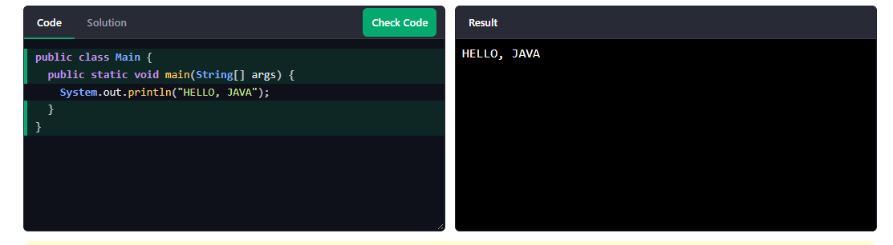

#  JAVA HOME 

ESTE PROGRAMA CUMPLE UNA FUNCION QUE INDICA LA RUTA EXACTA DEL DIRECTORIO RAIZ. HERRAMIENTAS DE DESARROLLO, COMPILADORES Y ENTORNOS DE EJECUCION NECESITAN SABER DONDE ENCONTRAR LOS EJECUTABLES DE JAVA.

1) CUANDO UNA APLICACION O IDE NECESITA COMPILAR O EJECUTAR UN CODIGO JAVA, CONSULTA PRIMERO LA VARIABLE JAVA_HOME PARA SABER DONDE BUSCAR

2) SI EN EL FUTURO ACTUALIZAS O CAMBIAS DE VERSION, SOLO NECESITA ACTUALIZAR EL VALOR DE JAVA_HOME EN LUGAR DE RECOONFIGURAR CADA HERRAMIENTA INDIVIDUALMENTE 

         # CODIGO 1

public class Main {
  public static void main(String[] args) {
    System.out.println("Hello World");
  }
}

# JAVA INTRO 

ES UNA GIA INTERACTIVA Y PANEL DE BIENVENIDA INCLUIDO EN LAS EXTENSIONES OFICIALES DE JAVA QUE AYUDA A VERIFICAR Y CONFIGURAR RAPIDAMENTE EL ENTORNO DE DEARROLLO, DETECTANTO AUTOMATICAMENTE L INSTALACION DEL JDK, PERMITIENDO GESTIONAR Y CAMBIAR ENTRE DISTINTAS VERSIONES DE JAVA, Y OFRECIENDO ACCESO DIRECTO A TUTORIALES PARA CREAR, COMPILAR Y EJECUTAR TUS PRIMEROS PROYECTOS 

         # CODIGO 2 

public class Main {
  public static void main(String[] args) {
    String name = "John";
    System.out.println("Hello " + name);
  }
}

# JAVA GET STARTED 

SU PROPISITO PRINCIPAL ES DETECTAR AUTOMATICAMENTE LA PRESENCIA DEL JDK EN EL SISTEMA, OFRECER ACCESOS DIRECTOS PARA CREAR PROYECTOS DESDE CERO, FACILITAR EL AJUSTE DE VERSIONES DE JAVA Y GUIAR EN EL PROCESO INICIAL 

          # CODIGO 3    

public class Main {
  public static void main(String[] args) {
    System.out.println("Hello World");
  }
}

# JAVA SYNTAX 

SE RIGE POR UNA ESTRUCTUR ESTRICTAMENTE ORIENTDA A OBJETOS DONDE TODO EL CODIGO EJECUTABLE DEBE RESIDIR DENTRO DE CLASES, DISTINGUIENDO FORMALMENTE ENTRE MAYUSCULAS Y MINISCULAS. AL SER UN LENGUAJE DE TIPADO ESTATICO, DAA VARIABLE REQUIERE LA DECLARACION EXPLICIT DE SU TIPO DE DATO ANTES DE SER UTILIZADA 

        #Codigo 

        public class Main {
  public static void main(String[] args) {
    System.out.println("Hello World");
  }
}

# JAVA - OUTPUT 

<h1> JAVA - OUTPUT 

ESTE SE REFIERE AL RPOCESO MEDIANTE EL CUAL EL PRGRAMA MUESTRA INFORMACION AL UUARIO, CONMUNMENTE A TRAVES DE LA CONSOLA O LA LINEA DE COMANDOS. ESTO SE REALIZA PRINCIPLAMENTE UTILIZANDO METODOS COMO SYSTEM.OUT.PRINTL() PARA IMPRIMIR TEXTO CON UN SALTO DE LINEA
 
 <h2> PRINT TEXT 
 
   <h3> EXAMPLE 1
  System.out.println("Hello World!");

   <h3> EXAMPLE 2
  System.out.println("Hello World!");
  System.out.println("I am learning Java.");
  System.out.println("It is awesome!");
 
<h2> PRINT NUMBERS 
 
   <h3> EXAMPLE 1 

System.out.println(3);
System.out.println(358);
System.out.println(50000);

   <h3> EXAMPLE 2

System.out.println(3 + 3);

   <h3>

System.out.println(2 * 5);

# JAVA COMMENTS

<h1> JAVA COMMENTS 

<h2> EXAMPLE 1
System.out.println("Hello World");

<h2> EXAMPLE 2
System.out.println("Hello World"); // This is a comment
